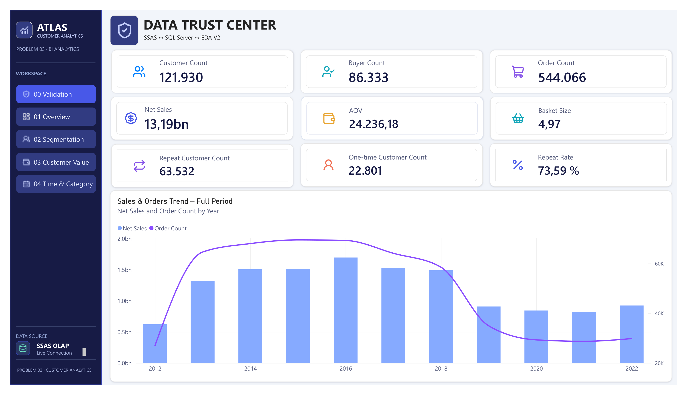
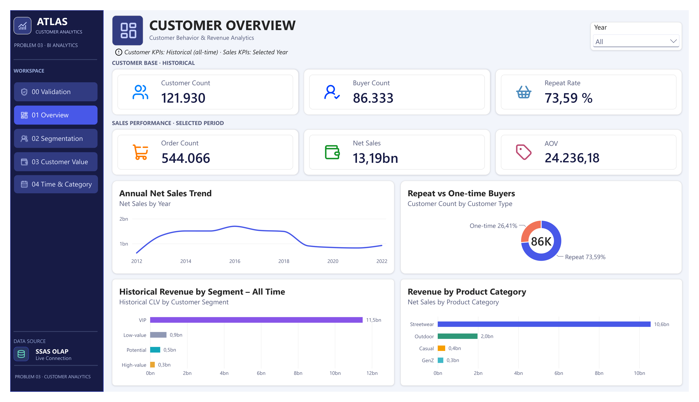
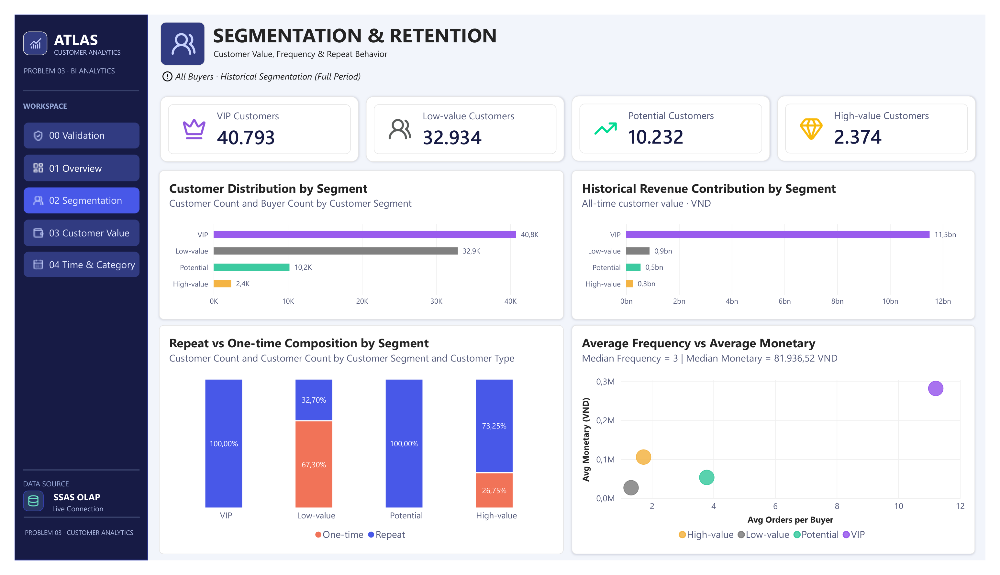
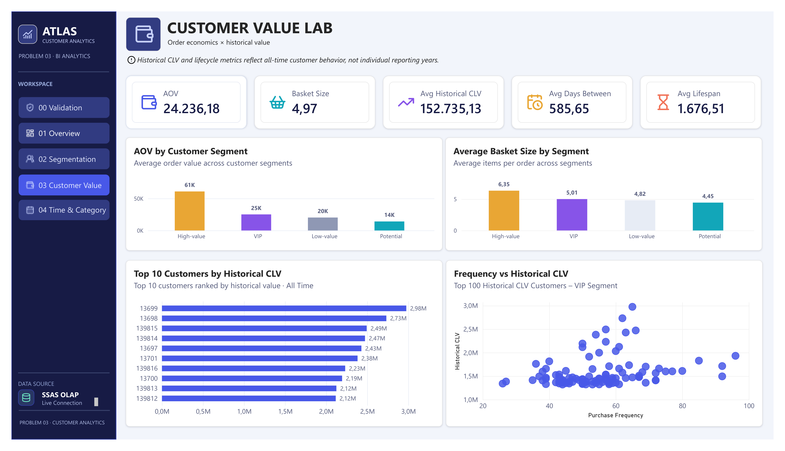
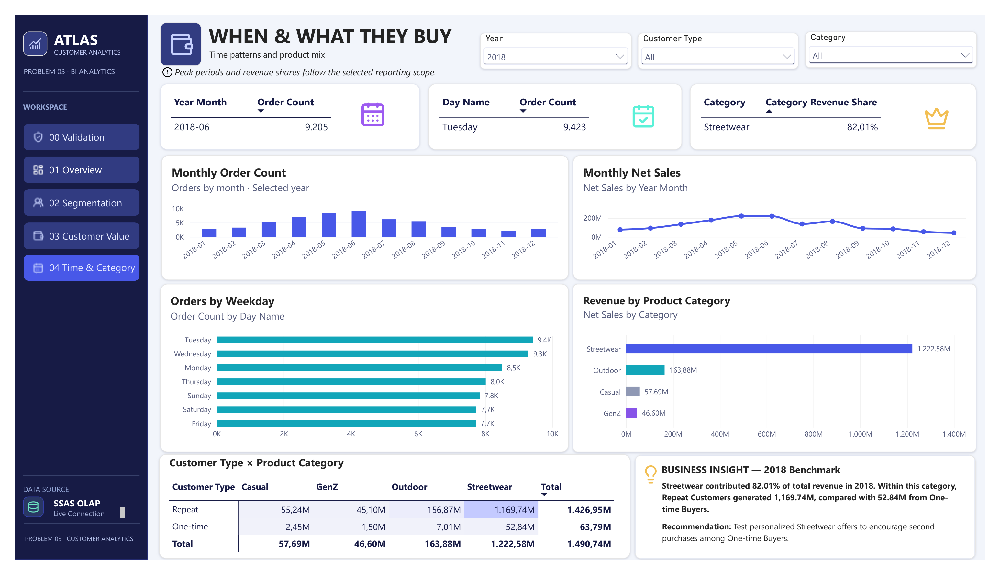

# DAAI_N1.3

## 📋 Jira

- Liên kết: (https://luanphan.atlassian.net/jira/software/projects/KAN/boards/2?filter=&groupBy=none&atlOrigin=eyJpIjoiNDg1OGJiNzZjZDdiNDQxYWI1NWZhNGNmNzVkZTViYzciLCJwIjoiaiJ9)

## 👥 Danh sách thành viên

| STT | MSSV | Họ và tên |
|:---:|:---:|---|
| 1 | 24680831 | Đặng Thị Hồng Anh |
| 2 | 24675951 | Phan Hoàng Luân |
| 3 | 24673981 | Huỳnh Tấn Nhàng |
| 4 | 24676931 | Võ Thị Hồng Nguyện |

## Dashboard Gallery - Customer Atlas

Power BI dashboard previews - Problem 3.

### Data Trust Center

### Customer Overview

### Segmentation & Retention

### Customer Value Lab

### When & What They Buy

